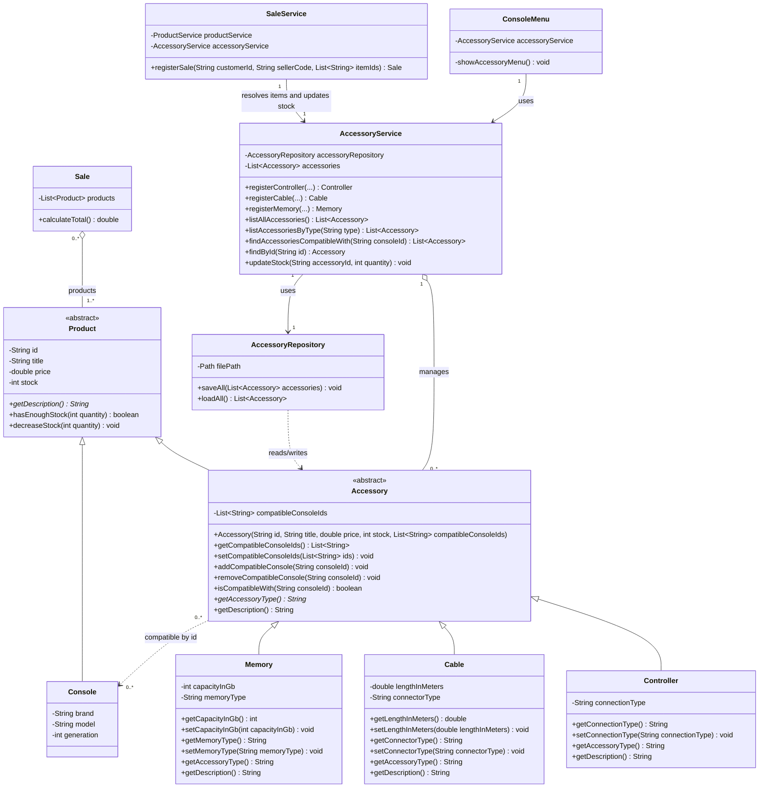

# Accessory Class Diagram - Requirement 1

The compatibility relationship is stored in `Accessory.compatibleConsoleIds`
as console identifiers, so it is drawn as a dependency by identifier and not
as an object reference.
