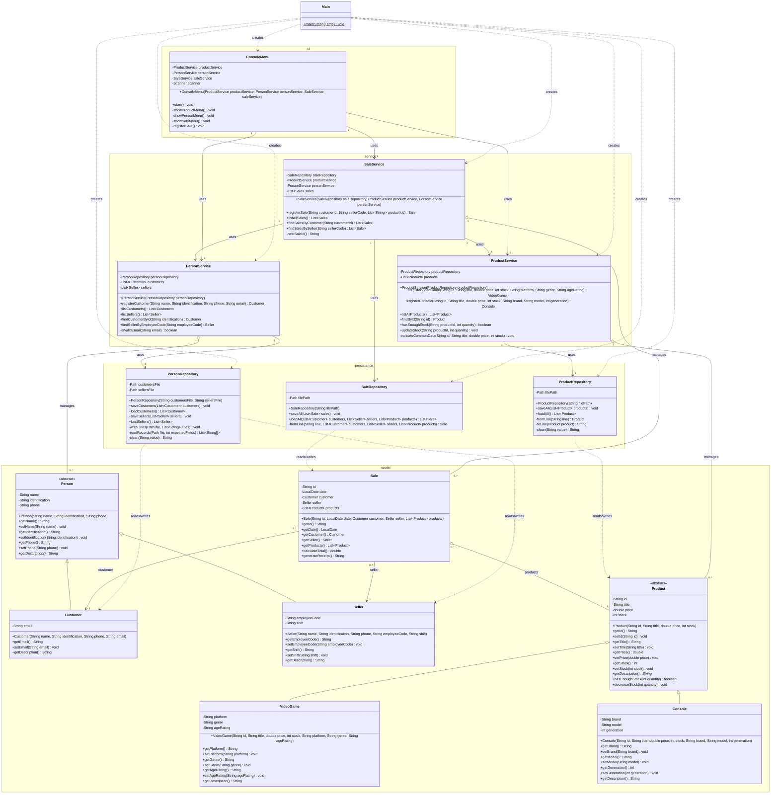

# Class Diagram - GameZone Unicesar

Complete class diagram of the system grouped by layer (namespaces `model`,
`persistence`, `service` and `ui`, plus the `Main` class of the root package).

Notation: `-` private, `+` public, `#` protected. Abstract classes are marked
with `<<abstract>>` and abstract methods end with `*`. Getters and setters of
every private attribute exist in the code; in the model they are listed
explicitly.

## Relationships summary

| Relationship                      | Type        | Multiplicity     |
|-----------------------------------|-------------|------------------|
| `Customer`, `Seller` -> `Person`  | Inheritance | -                |
| `VideoGame`, `Console` -> `Product` | Inheritance | -              |
| `Sale` -> `Customer`              | Association | `0..*` to `1`    |
| `Sale` -> `Seller`                | Association | `0..*` to `1`    |
| `Sale` -> `Product`               | Aggregation | `0..*` to `1..*` |
| Services -> Repositories          | Association | `1` to `1`       |
| `SaleService` -> `ProductService`, `PersonService` | Association | `1` to `1` |
| `ConsoleMenu` -> Services         | Association | `1` to `1`       |
| Repositories -> model classes     | Dependency  | -                |
| `Main` -> every layer             | Dependency  | -                |
