# Exception Class Diagram - Requirement 6

```mermaid
classDiagram
    direction TB

    namespace exceptions {
        class GameZoneException {
            <<abstract>>
            -String errorCode
            +GameZoneException(String message)
            +GameZoneException(String message, String errorCode)
            #GameZoneException(String message, String errorCode, Throwable cause)
            +getErrorCode() String
        }
        class ResourceNotFoundException {
            +ResourceNotFoundException(String resourceType, String resourceId)
        }
        class BusinessRuleException {
            +BusinessRuleException(String message)
        }
        class InvalidDataException {
            +InvalidDataException(String fieldName, String problem)
        }
        class PersistenceException {
            +PersistenceException(String message, Throwable cause)
        }
    }

    namespace validation {
        class ProductValidator {
            +validateProductData(String id, String title, double price, int stock)$ void
            +validateStockAvailability(Product product, int requestedQuantity)$ void
            +validateProductExists(Product product, String productId)$ void
            +requireText(String value, String fieldName)$ void
        }
        class PersonValidator {
            +validatePersonData(String id, String name, String email, String phone)$ void
            +validatePersonExists(Person person, String personType, String personId)$ void
            +validateUniquePerson(List~Person~ existing, String newId)$ void
        }
        class SaleValidator {
            +validateHasItems(List~String~ itemIds)$ void
            +validateSaleData(Customer customer, Seller seller, List~Product~ products)$ void
            +validateSaleExists(Sale sale, String saleId)$ void
        }
    }

    class RuntimeException
    class ProductService
    class PersonService
    class SaleService
    class AccessoryService
    class PromotionService
    class WarrantyService
    class ReturnService
    class Repositories["ProductRepository, PersonRepository, SaleRepository, ..."]
    class ConsoleMenu {
        -showError(RuntimeException error) void
    }
    class Main

    RuntimeException <|-- GameZoneException
    GameZoneException <|-- ResourceNotFoundException
    GameZoneException <|-- BusinessRuleException
    GameZoneException <|-- InvalidDataException
    GameZoneException <|-- PersistenceException

    ProductService ..> ProductValidator : validates with
    PersonService ..> PersonValidator : validates with
    SaleService ..> SaleValidator : validates with
    SaleService ..> PersonValidator : validates with
    SaleService ..> ProductValidator : validates with
    ProductValidator ..> BusinessRuleException : throws
    ProductValidator ..> InvalidDataException : throws
    ProductValidator ..> ResourceNotFoundException : throws
    PersonValidator ..> BusinessRuleException : throws
    PersonValidator ..> InvalidDataException : throws
    PersonValidator ..> ResourceNotFoundException : throws
    SaleValidator ..> BusinessRuleException : throws
    SaleValidator ..> InvalidDataException : throws
    SaleValidator ..> ResourceNotFoundException : throws
    AccessoryService ..> GameZoneException : throws subclasses
    PromotionService ..> GameZoneException : throws subclasses
    WarrantyService ..> InvalidDataException : throws
    ReturnService ..> GameZoneException : throws subclasses
    Repositories ..> PersistenceException : wraps IOException in
    ConsoleMenu ..> ResourceNotFoundException : catches
    ConsoleMenu ..> BusinessRuleException : catches
    ConsoleMenu ..> InvalidDataException : catches
    ConsoleMenu ..> PersistenceException : catches
    Main ..> PersistenceException : catches at startup
```

Services call the validators before executing an operation; validators never
call services or repositories. The exception package is cross-cutting and can
be used from any layer.
