# GRASP Class Diagrams - Requirement 7

## Before the correction

Classes involved in the violations of the consolidated audit, as they were at
the start of Phase 2.

```mermaid
classDiagram
    direction TB

    class ConsoleMenu {
        -Scanner scanner
        +start() void
        -showProductMenu() void
        -showPersonMenu() void
        -showSaleMenu() void
        -showAccessoryMenu() void
        -showPromotionMenu() void
        -showWarrantyMenu() void
        -showReturnMenu() void
        -readLine(String prompt) String
        -readInt(String prompt) int
        -readDouble(String prompt) double
        -readDate(String prompt) LocalDate
        -showError(RuntimeException error) void
    }
    note for ConsoleMenu "V-01: user interface of every module, input and errors in one class"

    class Product {
        <<abstract>>
        -int stock
        +hasEnoughStock(int quantity) boolean
        +decreaseStock(int quantity) void
        +getDescription()* String
    }
    note for Product "V-02: no operation to add stock; V-05: no category"
    class ProductService {
        +restoreStock(String productId, int quantity) void
    }
    class AccessoryService {
        +restoreStock(String accessoryId, int quantity) void
    }
    note for ProductService "V-02: product.setStock(product.getStock() + quantity)"

    class Sale {
        -List~Product~ products
        -double discountAmount
        +calculateTotal() double
        +getDiscountAmount() double
        +getProducts() List~Product~
    }
    class Return {
        -Sale sale
        -discountRate() double
        -refundOf(Product product) double
    }
    note for Return "V-03: calculates the discount rate of the sale"
    class ReturnService {
        -findInSale(Sale sale, String productId) Product
        -countInSale(Sale sale, String productId) int
    }
    note for ReturnService "V-04: iterates the items of the sale"

    class CategoryDiscount {
        -String targetCategory
        -belongsToTargetCategory(Product product) boolean
    }
    note for CategoryDiscount "V-05: instanceof VideoGame / Console / Accessory"
    class WarrantyService {
        +findWarrantyByProduct(String productId, String saleId) Warranty
    }
    note for WarrantyService "V-06: instanceof ExtendedWarranty"

    class ProductRepository
    class PersonRepository
    class SaleRepository
    class AccessoryRepository
    class PromotionRepository
    class WarrantyRepository
    class ReturnRepository
    note for SaleRepository "V-07: the seven repositories repeat Files.exists, readAllLines, createDirectories, write, IOException handling and clean()"

    ProductService ..> Product : setStock
    AccessoryService ..> Product : setStock
    Return --> Sale
    ReturnService ..> Sale : getProducts
    CategoryDiscount ..> Product : instanceof
```

## After the correction

The same classes with the new classes and methods introduced in Phase 2.

```mermaid
classDiagram
    direction TB

    class ConsoleMenu {
        -ConsoleInput input
        +start() void
    }
    note for ConsoleMenu "V-01: only the main menu; delegates to one submenu per module"
    class ConsoleInput {
        +readLine(String prompt) String
        +readText(String prompt) String
        +readInt(String prompt) int
        +readDouble(String prompt) double
        +readDate(String prompt) LocalDate
    }
    class ErrorPrinter {
        +print(RuntimeException error) void
    }
    class ProductMenu {
        +show() void
        +printProducts() void
    }
    class PersonMenu {
        +show() void
        +printCustomers() void
        +printSellers() void
    }
    class SaleMenu {
        +show() void
    }
    class AccessoryMenu {
        +show() void
        +printAccessories(List~Accessory~ accessories, String emptyMessage) void
    }
    class PromotionMenu {
        +show() void
    }
    class WarrantyMenu {
        +show() void
    }
    class ReturnMenu {
        +show() void
    }

    class Product {
        <<abstract>>
        -int stock
        +decreaseStock(int quantity) void
        +increaseStock(int quantity) void
        +getCategory()* String
    }
    note for Product "V-02: increaseStock; V-05: getCategory implemented by each product type"
    class Sale {
        +calculateDiscountRate() double
        +findProduct(String productId) Product
        +countUnitsOf(String productId) int
    }
    note for Sale "V-03, V-04: the sale answers about its discount and its items"
    class Return {
        -refundOf(Product product) double
    }
    class ReturnService
    class CategoryDiscount {
        -belongsToTargetCategory(Product product) boolean
    }
    class WarrantyService {
        +findWarrantyByProduct(String productId, String saleId) Warranty
    }
    note for WarrantyService "V-06: keeps the warranty with the longest getDurationInMonths()"
    class CsvFile {
        -Path path
        ~readLines(String errorMessage) List~String~
        ~writeLines(List~String~ lines, String errorMessage) void
        ~clean(String value)$ String
    }
    note for CsvFile "V-07: pure fabrication used by the seven repositories"
    class ProductRepository
    class SaleRepository
    class PersonRepository

    ConsoleMenu --> ConsoleInput
    ConsoleMenu --> ProductMenu
    ConsoleMenu --> PersonMenu
    ConsoleMenu --> SaleMenu
    ConsoleMenu --> AccessoryMenu
    ConsoleMenu --> PromotionMenu
    ConsoleMenu --> WarrantyMenu
    ConsoleMenu --> ReturnMenu
    ProductMenu --> ErrorPrinter
    SaleMenu --> PersonMenu
    SaleMenu --> ProductMenu
    SaleMenu --> AccessoryMenu
    ReturnMenu --> PersonMenu
    Return ..> Sale : calculateDiscountRate
    ReturnService ..> Sale : findProduct, countUnitsOf
    CategoryDiscount ..> Product : getCategory
    ProductRepository --> CsvFile
    SaleRepository --> CsvFile
    PersonRepository --> CsvFile
```

Every submenu receives the same `ConsoleInput` and `ErrorPrinter`. The other
repositories (`AccessoryRepository`, `PromotionRepository`,
`WarrantyRepository`, `ReturnRepository`) also use `CsvFile`.
