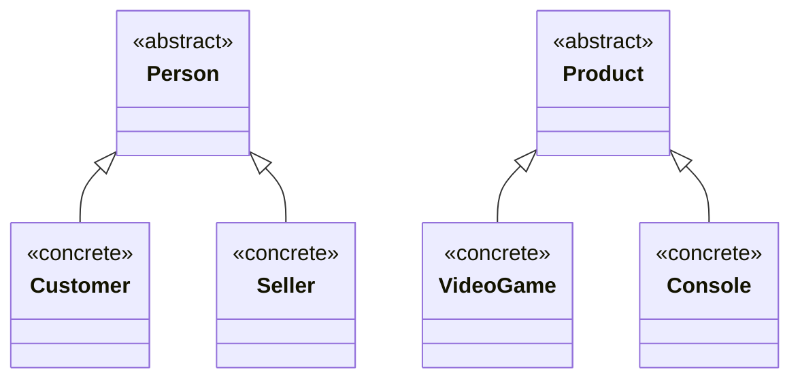

# Hierarchy Diagram - GameZone Unicesar

The diagram shows only the inheritance relationships of the model layer.
Abstract classes are marked with `<<abstract>>` and concrete classes with
`<<concrete>>`.

| Hierarchy | Base class (abstract) | Derived classes (concrete) |
|-----------|-----------------------|----------------------------|
| People    | `Person`              | `Customer`, `Seller`       |
| Products  | `Product`             | `VideoGame`, `Console`     |

`Sale` is a concrete model class that does not take part in any hierarchy.
