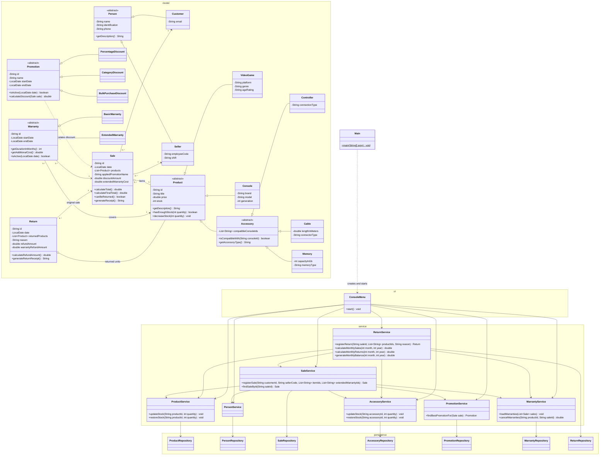

# Integrated Class Diagram - Requirement 5

Single class diagram of the integrated system, grouped by layer. Attributes
are private (`-`) and accessed through getters and setters, which are omitted
here to keep the diagram readable; see the module diagrams for the details.

