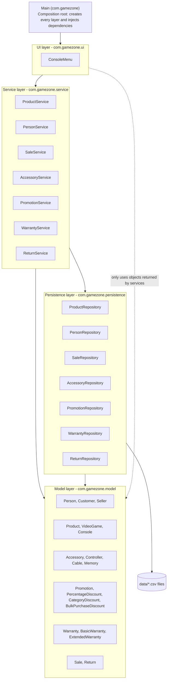

# Layers Diagram - GameZone Unicesar

The integrated system is organized in four layers. Arrows show the allowed dependency
direction: `ui -> service -> persistence -> model`, and `service -> model`.
The model does not depend on any other layer.

| Layer       | Classes                                                                                                   | May depend on                              |
|-------------|-----------------------------------------------------------------------------------------------------------|--------------------------------------------|
| UI          | `ConsoleMenu`                                                                                             | Service (and model objects returned by it) |
| Service     | `ProductService`, `PersonService`, `SaleService`, `AccessoryService`, `PromotionService`, `WarrantyService`, `ReturnService` | Persistence, Model                         |
| Persistence | `ProductRepository`, `PersonRepository`, `SaleRepository`, `AccessoryRepository`, `PromotionRepository`, `WarrantyRepository`, `ReturnRepository` | Model                                      |
| Model       | People, products, accessories, promotions, warranties, sales and returns                                  | None                                       |

After adjustment A2 no repository depends on a service: references between
files (sale of a warranty, sale of a return) are resolved from the objects
that the services pass to `loadAll`.
