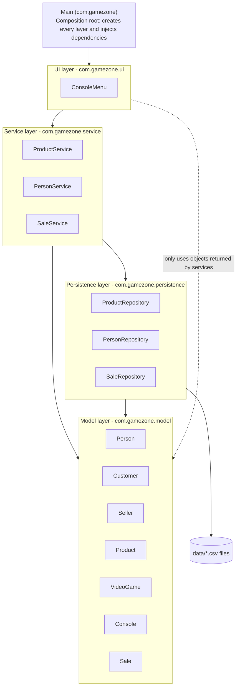

# Layers Diagram - GameZone Unicesar

The system is organized in four layers. Arrows show the allowed dependency
direction: `ui -> service -> persistence -> model`, and `service -> model`.
The model does not depend on any other layer.

| Layer       | Classes                                                                   | May depend on          |
|-------------|---------------------------------------------------------------------------|------------------------|
| UI          | `ConsoleMenu`                                                             | Service (and model objects returned by it) |
| Service     | `ProductService`, `PersonService`, `SaleService`                          | Persistence, Model     |
| Persistence | `ProductRepository`, `PersonRepository`, `SaleRepository`                 | Model                  |
| Model       | `Person`, `Customer`, `Seller`, `Product`, `VideoGame`, `Console`, `Sale` | None                   |

`ConsoleMenu` uses model objects only as values returned by the services
(for example, to print `getDescription()`); it never calls a repository.
