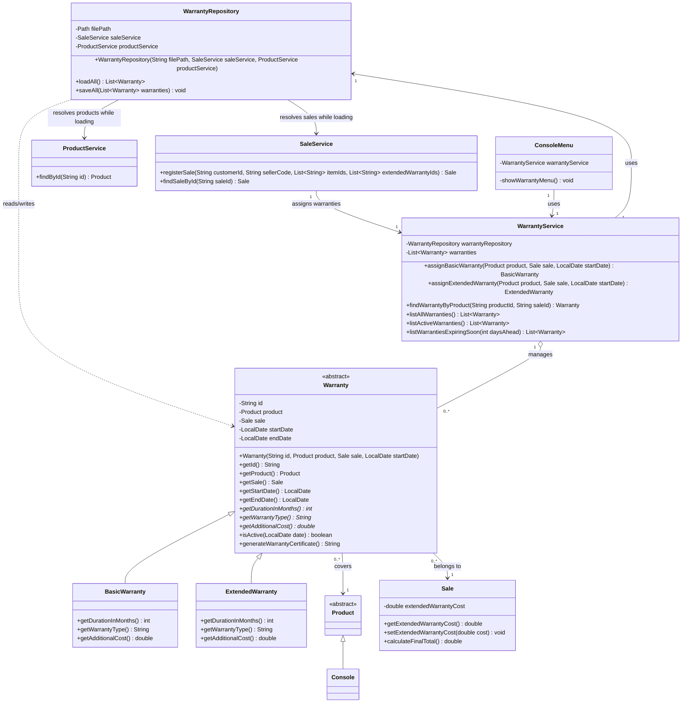

# Warranty Class Diagram - Requirement 4

With this design `WarrantyRepository` needs `SaleService` to load its data,
while `SaleService` needs `WarrantyService` to assign warranties. This
circular dependency is resolved in the integration adjustment A2.
